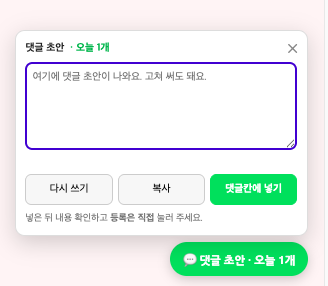

# 💬 Blog Comment Helper (블로그 댓글 도우미)

네이버 블로그 이웃 글을 AI가 읽고 **글 내용에 맞는 댓글 초안**을 써 주는 크롬 확장 프로그램입니다.

> **반자동 원칙:** 이 확장은 댓글 초안만 만들어 줍니다. **등록 버튼은 사람이 직접** 누릅니다.
> 블로그를 알아서 돌아다니거나 댓글을 대량으로 등록하지 않습니다.

<p align="center">
  
</p>

## 주요 기능

- **AI 댓글 초안:** 글 화면 오른쪽 아래 `💬 댓글 초안` 버튼을 누르면 제목과 본문(최대 2만 자)을 읽고 2~3문장 댓글을 써 줍니다.
- **답글 초안:** 내 글에 달린 댓글마다 `↩ 답글 초안` 버튼이 생깁니다. 내 글과 그 댓글을 읽고 1~2문장 답글을 써 줍니다.
- **가게 정보 정리:** 네이버 지도에서 가게를 열면 `📋 가게 정보 정리` 버튼이 생깁니다. 주소, 영업시간, 브레이크타임, 휴무, 주차, 전화 등을 페이지에 있는 내용만으로 정리해 복사할 수 있습니다. **리뷰 요약**(좋았던 점·많이 언급된 메뉴·아쉬운 점)과 **블로그 리뷰 제목 목록**도 가져올 수 있습니다.
- **편집과 전달:** 초안 창에서 다시 쓰기, 직접 수정, 복사, 댓글칸에 넣기를 할 수 있습니다.
- **오늘 댓글 수:** 복사할 때 1개씩 셉니다(같은 글은 하루 1개). 한국 시간 0시에 초기화되고, 설정 페이지에서 최근 7일 기록을 볼 수 있습니다.
- **맞춤 설정:** 말투, 길이, 내 블로그 소개, 추가 요청을 설정할 수 있습니다.
- **사진 읽기(선택, 기본 꺼짐):** 글 속 사진 2~6장을 AI가 함께 봅니다.

## 기술 스택

| 구분 | 내용 |
|---|---|
| 플랫폼 | Chrome Extension (Manifest V3) |
| AI | Google Gemini API (`gemini-3.1-flash-lite`, 무료 등급 사용 가능) |
| 저장 | `chrome.storage.local` (API 키, 설정, 댓글 수: 내 브라우저에만 저장) |
| 기타 | Content Script(네이버 블로그 iframe 대응), Service Worker, declarativeNetRequest |

## 구조

```
├── manifest.json   # 확장 설정과 권한
├── background.js   # Gemini API 호출, 사진 로드
├── content.js      # 블로그 화면 버튼과 초안 창, 본문 추출, 댓글칸 입력, 댓글 수 세기
├── place.js        # 네이버 지도 장소 페이지: 가게 정보, 리뷰 요약, 블로그 제목
├── content.css     # 초안 창 스타일
├── options.html    # 설정 페이지 (API 키, 말투, 최근 7일 기록)
├── options.js
└── docs/           # README 이미지
```

## 설치 방법

1. 이 저장소를 내려받습니다. (`Code` → `Download ZIP` 후 압축 풀기)
2. 크롬 주소창에 `chrome://extensions`를 입력하고 **개발자 모드**를 켭니다.
3. **압축해제된 확장 프로그램을 로드합니다**를 누르고 폴더를 선택합니다.
4. 확장 아이콘을 눌러 설정 페이지에서 **Gemini API 키**를 입력합니다.
   - [Google AI Studio](https://aistudio.google.com)에서 무료로 발급받을 수 있습니다.

## 사용 방법

1. 네이버 블로그 글을 엽니다.
2. `💬 댓글 초안`을 누릅니다.
3. 초안을 확인하고 필요하면 고친 뒤 **복사** 또는 **댓글칸에 넣기**를 누릅니다.
4. 네이버 댓글창의 **등록**은 직접 누릅니다.

## 개인정보와 보안

- API 키는 코드에 포함되지 않고 각자의 브라우저에만 저장됩니다.
- 글 본문(사진 읽기를 켜면 사진도)은 댓글 생성을 위해 Gemini API로만 전송됩니다.
- Gemini 무료 등급에서는 전송한 내용이 Google 서비스 개선에 사용될 수 있습니다.

## 버전 기록

- **v1.8.2:** 자동 재시도·예비 모델 제거, AI 호출은 한 번만 하고 실패하면 바로 안내
- **v1.8.0:** 네이버 지도에서 방문자 리뷰 요약, 블로그 리뷰 제목 목록
- **v1.7.0:** 네이버 지도 장소 페이지에서 영업시간·주차 등 가게 정보 정리
- **v1.6.0:** 내 글에 달린 댓글에 답글 초안 쓰기
- **v1.5.2:** 서버가 바쁠 때(503 등) 자동 재시도, 예비 모델 설정 추가
- **v1.5.1:** AI 특유의 과장된 표현을 줄이도록 프롬프트 보강
- **v1.5.0:** 이모지 제거, 사람이 쓴 것처럼 자연스러운 말투로 프롬프트 개선
- **v1.4.0:** 사진 읽기 기능 추가 (기본 꺼짐)
- **v1.3.0:** 복사할 때 댓글 수를 세고 초안 창에 오늘 개수 표시
- **v1.2.0:** 오늘 댓글 수, 한국 시간 0시 초기화
- **v1.1.x:** Claude API에서 Gemini API(무료)로 변경, 본문 읽기 한도 4천 자에서 2만 자로 확대
- **v1.0.0:** 첫 버전
